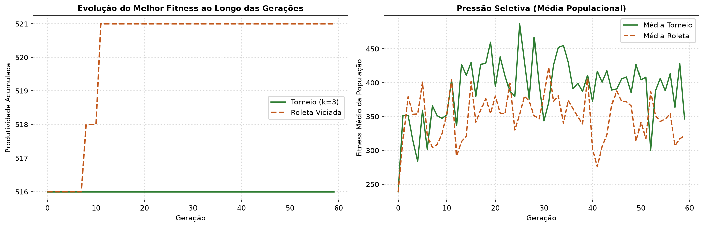

# 🧬 Otimização Combinatória Agrícola via Algoritmos Genéticos (Ir Além 2)

## 1. Contexto do Problema e Formulação Matemática

Na agricultura de precisão, a distribuição homogênea de insumos (defensivos agrícolas, fertilizantes e água) resulta em ineficiência produtiva e custos elevados. Diante de uma cota operacional máxima de **2.500 Litros** para um ciclo de manejo, a fazenda precisa selecionar quais talhões concorrentes serão tratados para maximizar a produtividade global da safra.

Modelamos essa decisão como um **Problema da Mochila Binária 0/1 (0/1 Knapsack Problem)**:

$$\text{Maximizar } Z = \sum_{i=1}^{n} v_i \cdot x_i$$

$$\text{Sujeito à restrição física: } \sum_{i=1}^{n} w_i \cdot x_i \le W_{\max}, \quad x_i \in \{0, 1\}, \quad \forall i \in \{1, \dots, n\}$$

Onde:

- $x_i \in \{0, 1\}$: Variável de decisão binária ($1 =$ aplicar insumo no talhão $i$; $0 =$ não aplicar);
- $v_i$: Ganho agronômico estimado em produtividade para o talhão $i$;
- $w_i$: Demanda volumétrica de calda/insumo do talhão $i$ (Litros);
- $W_{\max} = 2.500\text{ L}$: Capacidade volumétrica máxima do sistema de distribuição;
- $n = 10$: Talhões candidatos concorrentes (culturas de Café e Soja).

O espaço amostral possui $2^{10} = 1.024$ combinações possíveis. Para problemas reais com centenas de talhões, a enumeração exaustiva torna-se computacionalmente inviável, justificando o emprego de meta-heurísticas baseadas em computação evolutiva.

---

## 2. Arquitetura do Ciclo Evolutivo

A busca da solução ótima segue um ciclo biológico de operadores estocásticos com elitismo para evitar a perda de soluções dominantes:

<p align="center">
  
</p>

### Mecanismos Estruturantes:

1. **Entrada Estruturada e Reprodutibilidade:** Dados desacoplados no arquivo [`recursos_agricolas.json`](./recursos_agricolas.json), com semente fixa (`random.seed(42)`);
2. **Representação Cromossômica:** Vetor binário de tamanho 10;
3. **Mecanismo de Penalização (_Death Penalty_):** Cromossomos que violam a restrição operacional ($Consumo > 2.500\text{ L}$) recebem aptidão nula ($Fitness = 0$), impedindo a propagação de planos agrícolas inviáveis.

---

## 3. Justificativa Teórica de Hiperparâmetros

| Parâmetro                      |    Valor Adotado     | Justificativa Técnica                                                                                                                                        |
| :----------------------------- | :------------------: | :----------------------------------------------------------------------------------------------------------------------------------------------------------- |
| **Tamanho da População ($N$)** |          30          | Densidade amostral suficiente para cobrir o espaço de $2^{10}$ estados sem onerar a latência computacional.                                                  |
| **Critério de Parada ($G$)**   |     60 gerações      | Tempo assintótico necessário para convergência estável em ambas as estratégias de seleção.                                                                   |
| **Taxa de Crossover ($P_c$)**  | 80% (Ponto Simples)  | Alta frequência de recombinação para acelerar a troca de blocos construtivos favoráveis (_building blocks_).                                                 |
| **Taxa de Mutação ($P_m$)**    | 5% (Inversão de Bit) | Baseado na regra clássica de De Jong ($1/L = 1/10 = 0.10$). O valor de 0.05 equilibra a manutenção de diversidade e a preservação de esquemas já otimizados. |
| **Elitismo**                   |     1 indivíduo      | Preserva a melhor solução histórica diretamente para a geração subsequente, garantindo monotonicidade na convergência.                                       |

---

## 4. Comparação Experimental das Funções Estruturantes

Foram implementadas e comparadas duas abordagens distintas de seleção de progenitores:

| Métrica de Desempenho            | Seleção por Torneio Estocástico ($k=3$) | Seleção por Roleta Viciada (Fitness Proportionate) |
| :------------------------------- | :-------------------------------------: | :------------------------------------------------: |
| **Produtividade Máxima (Score)** |             **521 pontos**              |                   **521 pontos**                   |
| **Insumo Alocado (Litros)**      |               **2.500 L**               |                    **2.500 L**                     |
| **Eficiência no Uso da Cota**    |      **100.0% (Zero desperdício)**      |           **100.0% (Zero desperdício)**            |
| **Geração de Convergência**      |     **Geração 14** _(Mais rápida)_      |           **Geração 32** _(Mais lenta)_            |
| **Tempo de Execução (CPU)**      |              **~10.8 ms**               |                    **~8.3 ms**                     |

<p align="center">
  
</p>

### Análise Crítica dos Resultados:

- **Torneio Estocástico ($k=3$):** Atingiu a solução ótima na geração 14. A pressão seletiva constante eliminou rapidamente os indivíduos inviáveis, promovendo convergência mais rápida e robusta.
- **Roleta Viciada:** Atingiu o ótimo global apenas na geração 32. Como a roleta depende da soma cumulativa dos valores de fitness, gerações com grande quantidade de indivíduos penalizados ($Fitness = 0$) sofrem estagnação estocástica temporária.

---

## 5. Estudo de Sensibilidade da Taxa de Mutação ($P_m$)

Para validar a sensibilidade do algoritmo perante alterações estruturais, variamos a probabilidade de mutação mantendo os demais parâmetros fixos:

| Regime de Mutação ($P_m$) | Fitness Máximo | Consumo (L) | Comportamento Dinâmico Observado                                                                                      |
| :-----------------------: | :------------: | :---------: | :-------------------------------------------------------------------------------------------------------------------- |
|      **1% (Baixo)**       |      516       |   2.450 L   | **Subexploração:** População estagnou em ótimo local devido à perda prematura de alelos raros.                        |
|    **5% (Equilíbrio)**    |    **521**     | **2.500 L** | **Equilíbrio Ótimo:** Exploração adequada do espaço sem destruir blocos construtivos já estabelecidos.                |
|      **15% (Alto)**       |      521       |   2.500 L   | **Perturbação Excessiva:** Atingiu o ótimo, porém a média populacional oscilou fortemente, retardando a convergência. |

---

## 6. Tomada de Decisão Agronômica e Parecer de Campo

A solução ótima final prescreve o vetor binário $\mathbf{x}^* = [0, 0, 1, 0, 1, 1, 1, 1, 1, 0]$, alocando exatamente **2.500 Litros** de calda entre os talhões selecionados:

|  Talhão   | Cultura | Demanda (L) | Ganho Estimado | Eficiência ($v_i/w_i$) |    Decisão de Manejo    |   Volume Alocado   |
| :-------: | :-----: | :---------: | :------------: | :--------------------: | :---------------------: | :----------------: |
|  **T1**   |  Café   |    450 L    |      +92       |         0.2044         |     ⚪ Não Aplicar      |        0 L         |
|  **T2**   |  Café   |    600 L    |      +115      |         0.1917         |     ⚪ Não Aplicar      |        0 L         |
|  **T3**   |  Soja   |    300 L    |      +70       |         0.2333         |     🟢 **APLICAR**      |       300 L        |
|  **T4**   |  Café   |    550 L    |      +105      |         0.1909         |     ⚪ Não Aplicar      |        0 L         |
|  **T5**   |  Soja   |    400 L    |      +85       |         0.2125         |     🟢 **APLICAR**      |       400 L        |
|  **T6**   |  Café   |    700 L    |      +130      |         0.1857         |     🟢 **APLICAR**      |       700 L        |
|  **T7**   |  Soja   |    250 L    |      +60       |         0.2400         |     🟢 **APLICAR**      |       250 L        |
|  **T8**   |  Café   |    500 L    |      +98       |         0.1960         |     🟢 **APLICAR**      |       500 L        |
|  **T9**   |  Soja   |    350 L    |      +78       |         0.2229         |     🟢 **APLICAR**      |       350 L        |
|  **T10**  |  Café   |    480 L    |      +95       |         0.1979         |     ⚪ Não Aplicar      |        0 L         |
| **TOTAL** |    —    |      —      |       —        |           —            | **6 Talhões Atendidos** | **2.500 L (100%)** |

### Parecer Técnico:

1. **Aproveitamento Total da Cota:** 100.0% dos 2.500 Litros foram alocados, garantindo produtividade máxima de **521 pontos** sem desperdício de insumos.
2. **Priorização por Eficiência:** Todos os 4 talhões de **Soja** (T3, T5, T7 e T9) foram contemplados por possuírem densidade de ganho por litro superior ($0.21$ a $0.24$).
3. **Seleção Estratégica no Café:** Nos talhões de Café, o algoritmo priorizou T6 (700L / +130) e T8 (500L / +98). Embora o talhão T2 tivesse ganho absoluto expressivo (+115), sua demanda de 600L impedia a combinação ótima com os demais talhões.

---

## 7. Estrutura de Arquivos e Execução

```text
IR-ALEM/
├── recursos_agricolas.json                # Base estruturada de entrada (Reprodutibilidade)
├── algoritmo_genetico.py                  # Script Python modular para execução em CLI
├── otimizacao_genetica.ipynb              # Notebook Jupyter interativo com 12 etapas executadas
├── figura_autoral_algoritmo_genetico.png  # Diagrama arquitetural autoral do ciclo evolutivo
├── convergencia_geracoes.png              # Curvas de fitness e pressão seletiva
└── README.md                              # Este documento técnico
```
