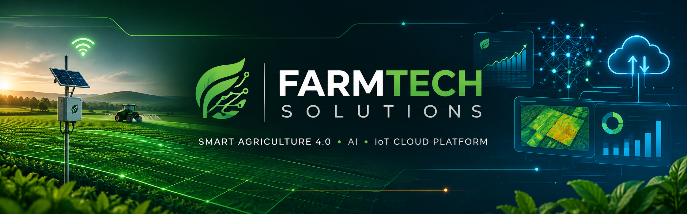
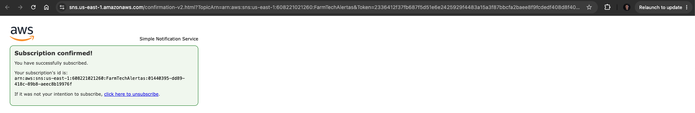
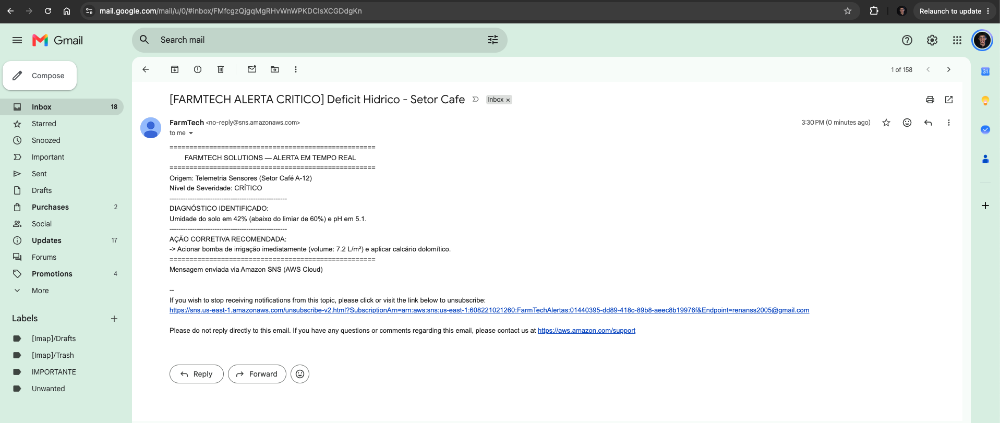

<div align="center">



# 🌱 FarmTech Solutions — Plataforma Integrada de Agricultura 4.0

### _Fase 7: A Consolidação de um Sistema — Ecossistema Cognitivo de Ponta a Ponta_

[](https://www.fiap.com.br/)
[](https://github.com/)
[](LICENSE)
[](https://www.python.org/)
[](https://streamlit.io/)
[](https://www.oracle.com/)
[](https://aws.amazon.com/)

</div>

---

## 👨‍🎓 Integrantes da Equipe

| Nome Completo                |   RM   |
| :--------------------------- | :----: |
| **Renan de Souza Silva**     | 568958 |
| **João Vitor Justino**       | 572969 |
| **Kevin Souza Santiago**     | 573808 |
| **Talles Duran das Virgens** | 572772 |
| **Thiese Barros de Novaes**  | 572659 |

## 👩‍🏫 Corpo Docente & Coordenação

- **Coordenador Geral:** [Prof. André Godoi Chiovato](https://www.linkedin.com/in/andregodoichiovato/)
- **Equipe de Avaliação:** Tutoria Acadêmica em Inteligência Artificial — FIAP

---

## 📜 Contexto e Alinhamento com o Enunciado (Fase 7)

Conforme estabelecido no PBL (_Project-Based Learning_) do curso de Inteligência Artificial da FIAP, a **FarmTech Solutions** atua como uma consultoria em inovação digital para o agronegócio.

O objetivo central desta **Fase 7 (A Consolidação de um Sistema)** não é desenvolver uma nova funcionalidade isolada, mas sim **integrar de forma coesa e funcional todos os serviços construídos ao longo das Fases 1 a 6** em uma única pasta de projeto (`farmtech-solutions-platform`), acionados por um Hub Central de Execução (Dashboard Streamlit) e suplementados por um serviço de mensageria em nuvem na infraestrutura da AWS.

---

## ⚙️ Arquitetura Integrada da Solução

```text
 ┌────────────────────────────────────────────────────────────────────────────────────────┐
 │                      ARQUITETURA CONSOLIDADA — FARMTECH SOLUTIONS                       │
 └────────────────────────────────────────────────────────────────────────────────────────┘

  [ CAMADA DE BORDA (IoT) ]             [ BANCO DE DADOS ]            [ CAMADA COGNITIVA ]
   ESP32 + Sensores NPK/pH                Oracle Database               Machine Learning
   DHT22 + Relé de Irrigação  ──(SQL)──▶  SENSORES_FARMTECH_IOT  ────▶   Random Forest Regressor
            │                                                                      │
            ▼                                                                      ▼
  [ TELEMETRIA CLIMÁTICA ]                                            [ VISÃO COMPUTACIONAL ]
   OpenWeather API (Chuva)                                             YOLOv5 / OpenCV Real
            │                                                          Detecção de Garrafa/Caneca
            │                                                                      │
            └───────────────────────────────┬──────────────────────────────────────┘
                                            ▼
                           ┌─────────────────────────────────┐
                           │   HUB CENTRAL EXECUTIVO (UI)    │
                           │       Streamlit Dashboard       │
                           │   Disparo & Controle em 1 Clique│
                           └────────────────┬────────────────┘
                                            ▼
                           ┌─────────────────────────────────┐
                           │     AWS CLOUD MESSAGING (SNS)   │
                           │  Alertas Automáticos SMS/Email  │
                           │     com Ações Agronômicas       │
                           └────────────────_________________┘
```

---

## 🚀 Mapeamento dos Serviços Integrados (Fases 1 a 6)

| Fase  | Módulo Técnico       | Pasta no Repositório      | Descrição da Funcionalidade Consolidada                                               |
| :---: | :------------------- | :------------------------ | :------------------------------------------------------------------------------------ |
| **1** | Manejo e Estatística | `src/fase1_planejamento/` | Cálculo geométrico de área (Café/Soja) e script estatístico em R integrado ao CSV.    |
| **2** | IoT e Borda          | `src/fase2_iot/`          | Firmware ESP32 (C++) com lógica NPK, pH via LDR, umidade DHT22 e OpenWeather.         |
| **3** | Persistência Oracle  | `src/fase3_database/`     | Ingestão corporativa com **MERGE** idempotente no Oracle DB da FIAP e DDLs schema.    |
| **4** | IA Preditiva         | `src/fase4_ml/`           | Regressão supervisionada e motor de regras agronômicas para tomada de decisão.        |
| **6** | Visão Computacional  | `src/fase6_vision/`       | Inferência real com YOLOv5/OpenCV, medição de latência (ms) e persistência de caixas. |
| **7** | Mensageria Cloud     | `src/fase7_alerts/`       | Monitoramento automatizado de limiares e disparo de alertas via Amazon SNS.           |

---

## ☁️ Evidências do Serviço de Alertas na AWS (Fase 7)

Conforme exigido pelo barema, o serviço de mensageria foi provisionado na região **`us-east-1` (N. Virginia)** devido às políticas de IAM do _AWS Academy Learner Lab_, com arquitetura conceitual voltada a **`sa-east-1` (São Paulo)** por conformidade à LGPD.

### 1. Tópico Standard `FarmTechAlertas` Criado:


### 2. Assinatura de E-mail Confirmada:



### 3. Notificação Real Recebida pelo Operador:



---

## 🧬 Módulo Opcional: Ir Além 2 (Otimização por Algoritmos Genéticos)

Implementado na pasta **`IR-ALEM/`**, este módulo resolve a alocação ótima de insumos entre 10 talhões agrícolas sob o teto de 2.500 Litros (Problema da Mochila Binária).

- **Figura Autoral do Ciclo Evolutivo:**
  <p align="center"></p>

- **Curvas de Convergência (Torneio vs Roleta):**
  <p align="center"></p>

---

## 🧪 Qualidade de Código & Testes Unitários

O projeto conta com uma suíte automatizada de testes em `tests/test_integracao.py` que valida a integridade do CSV, o comportamento dos alertas e os mocks de infraestrutura:

```bash
python -m unittest discover -s tests -v
```

_(Resultado: 11 testes executados com 100% de aprovação)._

---

## 🔧 Como Executar a Plataforma

```bash
# 1. Clone o repositório e acesse a pasta
git clone https://github.com/SEU_USUARIO/farmtech-solutions-platform.git
cd farmtech-solutions-platform

# 2. Crie e ative o ambiente virtual
python3 -m venv .venv
source .venv/bin/activate  # No Windows: .venv\Scripts\Activate.ps1

# 3. Instale as dependências
pip install --upgrade pip
pip install -r requirements.txt

# 4. Configure o arquivo de ambiente
cp .env.example .env

# 5. Inicie o Hub Executivo (Streamlit)
streamlit run src/dashboard/app.py
```

---

## 📎 Links de Entrega (TODO)

- [TODO: Inserir link do Vídeo Demonstrativo Geral no YouTube (Até 10 min, não listado)]
- [TODO: Inserir link do Vídeo do Ir Além 2 no YouTube (Opcional, até 4 min)]

---

## 📋 Licença e Conformidade

<p xmlns:cc="http://creativecommons.org/ns#" xmlns:dct="http://purl.org/dc/terms/"><a property="dct:title" rel="cc:attributionURL" href="https://github.com/fiap-tutoria/FIAP-PORTFOLIO-AI">TEMPLATE - FIAP PORTFÓLIO AI</a> por <a rel="cc:attributionURL dct:creator" property="cc:attributionName" href="https://fiap.com.br">FIAP</a> está licenciado sobre <a href="http://creativecommons.org/licenses/by/4.0/?ref=chooser-v1" target="_blank" rel="license noopener noreferrer" style="display:inline-block;">Attribution 4.0 International</a>.</p>
