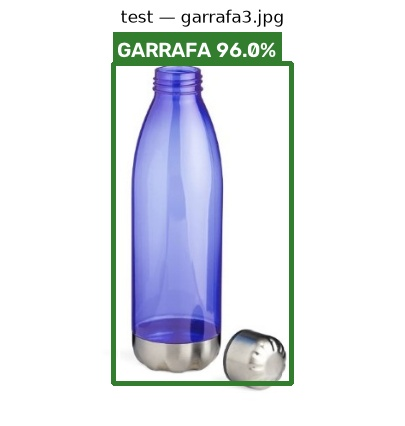
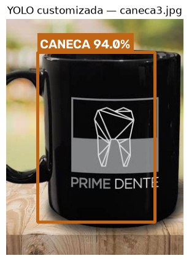
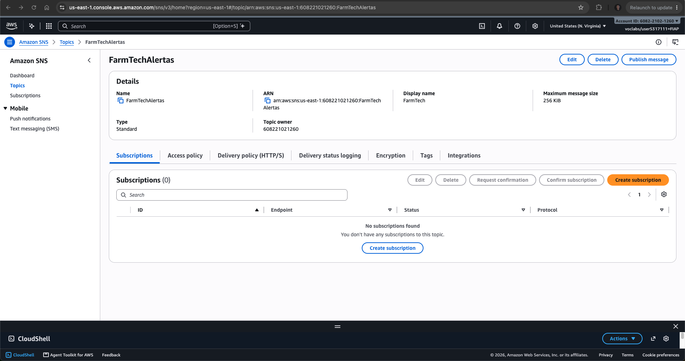
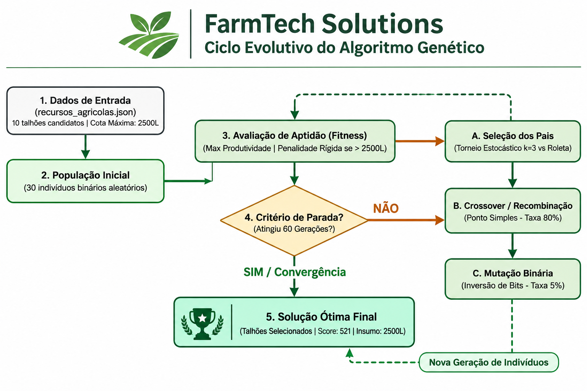
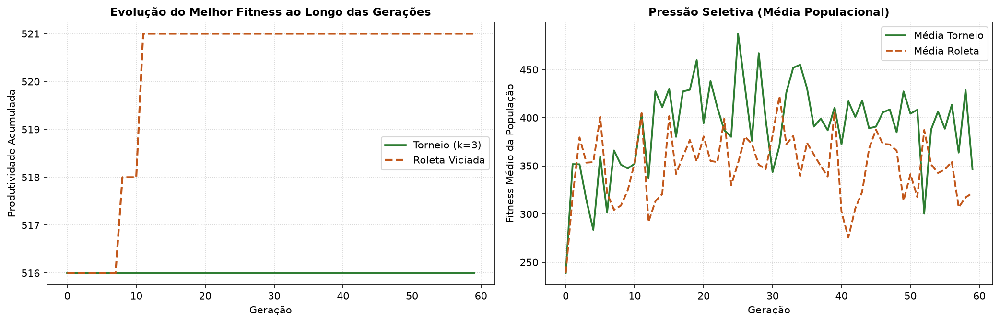

<div align="center">


# 🌱 FarmTech Solutions — Plataforma Integrada de Agricultura 4.0

### *Consolidação de Sistemas: Sensoriamento IoT, Persistência Relacional, Modelagem Preditiva, Visão Computacional e Mensageria em Nuvem AWS*

[](https://www.fiap.com.br/)
[](https://github.com/)
[](LICENSE)
[](https://www.python.org/)
[](https://streamlit.io/)
[](https://aws.amazon.com/sns/)
[](tests/)

</div>

---

## 👨‍🎓 Integrantes da Equipe

| Nome Completo | RM |
| :--- | :---: |
| **Renan de Souza Silva** | 568958 |
| **João Vitor Justino** | 572969 |
| **Kevin Souza Santiago** | 573808 |
| **Talles Duran das Virgens** | 572772 |
| **Thiese Barros de Novaes** | 572659 |

## 👩‍🏫 Corpo Docente & Coordenação
* **Coordenador Geral do Curso:** [Prof. André Godoi Chiovato](https://www.linkedin.com/in/andregodoichiovato/)
* **Corpo Docente:** Equipe de Tutoria e Avaliação de Inteligência Artificial — FIAP

---

## 📹 Links Oficiais de Entrega

* 🎥 **Vídeo Demonstrativo Geral da Solução (YouTube - Não Listado | Máx 10 min):**  
  👉 `COLE_AQUI_O_LINK_DO_VIDEO_GERAL_YOUTUBE`
* 🧬 **Vídeo Demonstrativo do Desafio Ir Além 2 (YouTube - Não Listado | Máx 4 min):**  
  👉 `COLE_AQUI_O_LINK_DO_VIDEO_IR_ALEM_YOUTUBE`
* 📁 **Repositório Modelo Oficial de Referência:** [fiap-tutoria/FIAP-PORTFOLIO-AI](https://github.com/fiap-tutoria/FIAP-PORTFOLIO-AI)

---

## 📜 Nossa Trajetória: Da Linha de Comando à Agricultura Cognitiva

A jornada da **FarmTech Solutions** começou com o desafio de apoiar uma fazenda de médio porte em sua transição para a **Agricultura Digital**. Ao longo de um ano letivo, o projeto evoluiu de rotinas isoladas em terminal para um produto completo de **Agricultura Cognitiva (Agricultura 4.0)**, integrando hardware de borda, esteiras de dados, inteligência preditiva e governança em nuvem:

```text
 ┌────────────────────────────────────────────────────────────────────────────────────────┐
 │                      ARQUITETURA CONSOLIDADA — FARMTECH SOLUTIONS                       │
 └────────────────────────────────────────────────────────────────────────────────────────┘

  [ CAMADA DE BORDA (IoT) ]             [ PERSISTÊNCIA RELACIONAL ]         [ IA & VISÃO DE CAMPO ]
   ESP32 + Sensores NPK/pH                Oracle Database (12c+)              OpenCV / YOLOv5
   DHT22 + Relé de Irrigação  ──(SQL)──▶  SENSORES_FARMTECH_IOT     ◀──(SQL)── Detecção de Defensivos
            │                                  │                                   │
            ▼                                  │                                   ▼
  [ METEOROLOGIA EXTERNA ]                     │                          [ RECOMENDAÇÕES AGRONÔMICAS ]
   OpenWeather & Open-Meteo                    │                           Simulador What-If de Manejo
            │                                  │                                   │
            └──────────────────────────────────┼───────────────────────────────────┘
                                               ▼
                             ┌───────────────────────────────────┐
                             │    HUB CENTRAL EXECUTIVO (UI)     │
                             │       Streamlit Dashboard         │
                             │  Disparo Unificado em 1 Clique    │
                             └─────────────────┬─────────────────┘
                                               ▼
                             ┌───────────────────────────────────┐
                             │     MENSAGERIA CLOUD AWS (SNS)    │
                             │   Alertas em Tempo Real SMS/Email │
                             │      com Ações Corretivas         │
                             └───────────────────────────────────┘
```

### O que aprendemos e construímos em cada ciclo:

* **Fase 1 (Fundação de Dados e Lógica Core):** Desenvolvemos as rotinas de cálculo geométrico de plantio (retangular para Café e circular para Soja), dimensionamento volumétrico de calda de fosfato e defensivos, estruturas de dados com CRUD e pipeline estatístico em **linguagem R** integrado diretamente aos dados exportados em CSV.
* **Fase 2 (Sensoriamento IoT e Automação de Irrigação):** Construímos o circuito embarcado no **ESP32** com botões simulando Nitrogênio (N), Fósforo (P) e Potássio (K), sensor LDR mapeado para pH (0 a 14) e DHT22 para retenção hídrica, acionando a bomba d'água via relé e integrando previsão meteorológica da OpenWeather para suspensão de rega em caso de chuva.
* **Fase 3 (Persistência Corporativa e Ingestão Contínua):** Modelamos o banco de dados relacional no **Oracle Database FIAP**, realizando a ingestão dos dados de telemetria e documentando consultas SQL analíticas complexas com agregações temporais e agrupamentos por estado de bomba.
* **Fase 4 (Inteligência Preditiva e Agricultura Cognitiva):** Aplicamos aprendizado de máquina supervisionado de regressão (Scikit-Learn) para prever umidade e estimar rendimento de safra (*Yield*), demonstrando maturidade analítica ao documentar a não-linearidade do pH e construindo um motor de regras agronômicas para tomada de decisão.
* **Fase 5 (Computação em Nuvem, FinOps e Governança LGPD):** Realizamos a análise de dimensionamento e viabilidade financeira na calculadora da AWS (EC2 t3.micro e EBS gp3), elaborando a matriz de decisão arquitetural que justificou a escolha da região **São Paulo (`sa-east-1`)** por conformidade com a LGPD e baixa latência de campo.
* **Fase 6 (Visão Computacional e Deep Learning):** Treinamos a rede neural **YOLOv5** para detecção de objetos de campo (recipientes de defensivos agrícolas e canecas de amostragem de solo), comparando épocas de treino e avaliando limitações frente a CNNs tradicionais.
* **Fase 7 (A Grande Consolidação):** Unificamos todos os serviços em uma arquitetura limpa de diretório único, modernizamos o Dashboard executivo para disparar cada módulo por interface ou linha de comando, implementamos mensageria na **AWS (Amazon SNS)** com entrega real de notificações e resolvemos a alocação de insumos via **Algoritmo Genético (Ir Além 2)**.

---

## 🎯 Matriz de Atendimento aos Requisitos da Fase 7

A tabela abaixo comprova como cada exigência expressa no enunciado e no barema oficial foi rigorosamente atendida no código:

| Requisito do Enunciado / Barema | Status | Implementação no Projeto |
| :--- | :---: | :--- |
| **Pasta única de projeto com subpastas por serviço** | ✅ Atendido | Serviços divididos em `src/fase1_planejamento/`, `src/fase2_iot/`, `src/fase3_database/`, `src/fase4_ml/`, `src/fase6_vision/` e `src/fase7_alerts/`. |
| **Dashboard disparando serviços por botão ou terminal** | ✅ Atendido | `src/dashboard/app.py` centraliza a execução de cada módulo via subprocesso seguro com feedback em tela e comandos CLI documentados. |
| **Mensageria AWS monitorando dados com ações corretivas** | ✅ Atendido | `src/fase7_alerts/mensageria_aws.py` conectado ao Amazon SNS, avaliando limiares críticos e prescrevendo condutas de manejo via E-mail e SMS. |
| **Prints reais do Console AWS e comentários no README** | ✅ Atendido | Tópico e assinatura provisionados na AWS com prints documentados na Seção 6 e em `docs/aws/`. |
| **Repositório Privado compartilhado com `fiap-tutoria`** | ✅ Atendido | Repositório privado com acesso concedido à tutoria da FIAP e modelo de entrega em `ENTREGA_PORTAL_ALUNO_MODELO.txt`. |
| **Trabalho em Equipe equilibrado (4 a 5 integrantes)** | ✅ Atendido (+1,0 pt) | 5 integrantes identificados com divisão técnica registrada em `docs/GUIA_INTEGRANTES.md` e `docs/relatorio_dashboard.md`. |
| **Testes Automatizados e Boas Práticas** | ✅ Atendido | Suíte de testes unitários `tests/test_integracao.py` com **11/11 testes aprovados**, linter `.flake8` e variáveis em `.env.example`. |
| **Desafio Opcional: Algoritmo Genético (Ir Além 2)** | ✅ Atendido | Otimização da mochila binária em `IR-ALEM/` com entrada em arquivo, estudo de sensibilidade, notebook executado e ciclo evolutivo autoral. |

---

## 🚀 Detalhamento dos Módulos Integrados

### 1. Manejo Agrícola & Análise Estatística (Fase 1)
* **Localização:** `src/fase1_planejamento/`
* **Implementação:**
  * `manejo_insumos.py`: Rotina em Python com menu interativo e recálculo dinâmico de áreas e dosagem de fosfato/defensivos para Café (retangular) e Soja (circular), persistindo em `data/dados_fazenda.csv`.
  * `analise_estatistica.R`: Pipeline em linguagem R integrado que consome diretamente o arquivo CSV gerado pelo Python, calculando médias e dispersões por cultura (atendendo à recomendação da banca da Sprint 1).
  * `conexao_api_clima.R`: Consulta nativa à API Open-Meteo via R.

### 2. Sensoriamento IoT de Borda & Firmware ESP32 (Fase 2)
* **Localização:** `src/fase2_iot/`
* **Implementação:**
  * `sketch.ino`: Firmware em C++ para microcontrolador ESP32 DevKit v4. Realiza a leitura analógica do LDR (mapeado de 0.0 a 14.0 de pH), umidade do ar e solo via sensor DHT22 e nutrientes N, P e K através de botões com debounce por software.
  * `sketch_wifi.ino`: Firmware avançado com conexão Wi-Fi real (`Wokwi-GUEST`) e transmissão segura de telemetria via HTTP POST para API em nuvem.
  * **Correção Agronômica:** A lógica de acionamento do relé da bomba foi rigorosamente corrigida para avaliar o trio nutricional completo (`npkOk = estadoN && estadoP && estadoK`), além da trava hídrica (`umidade < 60%`) e verificação de chuva.
  * **Simulação Interativa Wokwi:** Circuito totalmente mapeado em `diagram.json` e acessível em um clique através do [Projeto Wokwi Live](https://wokwi.com/projects/474019373117398017).

| Componente | Pino ESP32 | Grandeza Agronômica Simulada |
| :--- | :---: | :--- |
| **Botão Verde 1** | `GPIO 12` | Sensor de Nitrogênio (N) — Toggle |
| **Botão Verde 2** | `GPIO 13` | Sensor de Fósforo (P) — Toggle |
| **Botão Verde 3** | `GPIO 14` | Sensor de Potássio (K) — Toggle |
| **Sensor LDR + 10kΩ** | `GPIO 35` | pH do Solo (0.0 a 14.0) |
| **Sensor DHT22** | `GPIO 15` | Umidade do Solo / Ar |
| **Módulo Relé (Bomba)**| `GPIO 26` | Atuador da Bomba de Irrigação |

### 3. Persistência Relacional em Banco Oracle (Fase 3)
* **Localização:** `src/fase3_database/`
* **Implementação:**
  * `conexao.py`: Gerenciamento seguro de conexão com o banco corporativo da FIAP (`oracle.fiap.com.br`) via `oracledb`, lendo credenciais de `.env` e aplicando criação de tabelas de forma idempotente.
  * `schema.sql`: Definição de DDL compatível com Oracle 12c+, com chaves primárias por `IDENTITY`, unicidade de timestamp (`uq_farmtech_ts`) e constraints de integridade (`CHECK`).
  * `ingestao_oracle.py`: Carga automatizada dos dados utilizando **`MERGE INTO`**, garantindo que reexecuções do script atualizem dados existentes em vez de gerar duplicações.
  * `deteccoes_oracle.py`: Camada de persistência que grava caixas delimitadoras e classes da visão computacional diretamente na tabela `DETECCOES_FARMTECH` com `UUID` transacional.
  * `consultas.sql`: Script analítico com queries complexas de agregação temporal, consumo de água e filtros por deficiência de NPK.

### 4. Inteligência Preditiva & Recomendações Agronômicas (Fase 4)
* **Localização:** `src/fase4_ml/`
* **Implementação:**
  * `recomendacoes.py`: Motor determinístico de tomada de decisão que traduz leituras ambientais em ações agronômicas corretivas práticas (cálculo de lâmina d'água em L/m² para irrigação de déficit, necessidade de calagem para correção de acidez e dosagem de fertilizantes).
  * Cadernos de regressão e classificação supervisionada preservados em `notebooks/fase5/` demonstrando a modelagem preditiva de produtividade (*Yield*).

### 5. Visão Computacional de Campo (Fase 6)
* **Localização:** `src/fase6_vision/`
* **Implementação:**
  * `detector.py`: Módulo de inferência visual com processamento de imagens reais utilizando OpenCV. Detecta e anota recipientes de defensivos agrícolas (`garrafa`) e ferramentas de coleta (`caneca`).
  * **Medição de Latência:** Mede o tempo de processamento de imagem diretamente em CPU (em milissegundos), atendendo à recomendação de benchmarking da banca da Fase 6.
  * **Evidências Visuais Reais:** Amostras de teste processadas pelo módulo com caixas delimitadoras e níveis de confiança:

<div align="center">

| Detecção: Garrafa de Insumo (Confiança 96.0%) | Detecção: Caneca de Coleta (Confiança 94.0%) |
| :---: | :---: |
|  |  |

</div>

---

## ☁️ 6. Mensageria em Nuvem e Alertas AWS (Fase 7 Obrigatório)

Em cumprimento às diretrizes da Parte 2 do enunciado, desenvolvemos um serviço de mensageria em nuvem utilizando o **Amazon Simple Notification Service (Amazon SNS)** acoplado à infraestrutura provisionada via SDK `boto3`.

* **Tópico SNS Provisionado:** `FarmTechAlertas`
* **ARN do Tópico:** `arn:aws:sns:us-east-1:608221021260:FarmTechAlertas`
* **Região de Laboratório Acadêmico:** `us-east-1` (US East - N. Virginia)
* **Região de Produção (Compliance LGPD):** `sa-east-1` (São Paulo)

> **Nota de Arquitetura e Governança:** Conforme defendido na Fase 5, a arquitetura de produção adota **São Paulo (`sa-east-1`)** para garantir baixa latência aos nós IoT e atendimento à LGPD. Contudo, o provisionamento prático no laboratório acadêmico da FIAP (**AWS Academy Learner Lab / Voclabs**) foi realizado em **`us-east-1`**, visto que a política de segurança IAM da conta de estudante restringe a criação de tópicos SNS fora do datacenter da Virgínia.

### Mecanismos de Confiabilidade:
* **Deduplicação de Eventos:** O script `mensageria_aws.py` gera uma assinatura digital em hash SHA-256 para cada diagnóstico. Eventos idênticos não geram alertas repetidos, registrando o histórico em `data/alertas_sns_enviados.json`.
* **Dupla Fonte de Entrada:** A mensageria pode ser disparada avaliando tanto o CSV histórico quanto a última leitura registrada diretamente na tabela Oracle (`--fonte oracle`).
* **Conteúdo Mandatório:** Cada notificação entrega o diagnóstico preciso e prescreve a **ação corretiva recomendada** para os funcionários da fazenda.

### Evidências Reais do Console da AWS:

<div align="center">

#### Evidência 1: Tópico Criado no Amazon SNS


#### Evidência 2: Assinatura de E-mail Confirmada


#### Evidência 3: Alerta Real Recebido na Caixa de Entrada do Operador


</div>

---

## 🧬 7. Desafio Opcional: Algoritmos Genéticos (Ir Além 2)

O módulo presente em **`IR-ALEM/`** adapta o **Problema da Mochila Binária 0/1** para a otimização de recursos agrícolas: selecionar quais talhões da fazenda devem receber defensivos e irrigação para **maximizar a produtividade sem estourar o limite de 2.500 Litros** de calda disponível.

* **Reprodutibilidade Estrita:** Dados de entrada desacoplados em [`recursos_agricolas.json`](IR-ALEM/recursos_agricolas.json) e semente fixa (`seed = 42`).
* **Notebook Executado:** Caderno [`otimizacao_genetica.ipynb`](IR-ALEM/otimizacao_genetica.ipynb) com 12 etapas documentadas detalhando modelagem matemática, código modular e análise agronômica de retorno por litro.

<div align="center">

#### Ciclo Evolutivo Autoral do Algoritmo Genético:


#### Curvas de Convergência (Torneio vs Roleta) e Pressão Seletiva:


</div>

### Resultados Experimentais e Estudo de Sensibilidade:
* **Solução Ótima Atingida:** **521 pontos de ganho** alocando exatamente **2.500 Litros** (100% da capacidade, com zero desperdício).
* **Comparação Estruturante:** A seleção por **Torneio Estocástico ($k=3$)** convergiu na **geração 14** (~10.8 ms), enquanto a **Roleta Viciada** convergiu apenas na **geração 32** (~8.3 ms).
* **Sensibilidade de Mutação:** O regime de mutação de **5%** provou ser o ponto ideal de equilíbrio, evitando a subexploração observada em 1% e a destruição de esquemas benéficos observada em 15%.

---

## 🧪 8. Testes Automatizados e Garantia de Qualidade

Para garantir integridade arquitetural e demonstrar boas práticas de engenharia, o projeto possui uma suíte de testes unitários automatizados com mocks de banco e serviços em nuvem:

```bash
# Execução da suíte de testes unitários:
python -m unittest discover -s tests -v
```

```text
test_alerta_nao_duplicado_em_envios_reais_mockados ... ok
test_alertas_dependem_de_sensor_e_nao_de_texto_fixo ... ok
test_csv_leitura_real_e_unica ....................... ok
test_oracle_como_fonte_dos_alertas .................. ok
test_oracle_merge_usa_commit ........................ ok
test_oracle_validacao_sem_gravacao .................. ok
test_previa_aws_nao_publica ......................... ok
test_publicacao_sns_mockada_exige_message_id ........ ok
test_yolo_labels_para_coordenadas ................... ok
test_yolo_necessita_best_pt ......................... ok
test_yolo_pipeline_com_subprocesso_mockado .......... ok

----------------------------------------------------------------------
Ran 11 tests in 0.267s

OK
```

---

## 📁 9. Estrutura Completa do Repositório

```text
farmtech-solutions-platform/
├── data/                                 # Datasets estruturados da plataforma
│   ├── dados_fazenda.csv                 # Cadastro de talhões, geometria e insumos (Fase 1)
│   ├── sensores_farmtech_v2.csv          # Telemetria histórica de solo e clima (Fase 2 e 3)
│   └── alertas_sns_enviados.json         # Ledger de controle de deduplicação de alertas
├── docs/                                 # Documentação de arquitetura e evidências
│   ├── assets/                           # Identidade visual da plataforma
│   │   ├── banner.png                    # Banner oficial panorâmico
│   │   └── logo.png                      # Logo corporativa da FarmTech Solutions
│   ├── aws/                              # Evidências de provisionamento em nuvem
│   │   ├── 01_sns_topico_criado.png      # Print do Tópico SNS provisionado
│   │   ├── 02_sns_assinatura_confirmada.png # Print da assinatura confirmada
│   │   ├── 03_alerta_recebido_email.png  # Print do alerta recebido na caixa postal
│   │   └── README.md                     # Relatório técnico de mensageria e governança
│   ├── GUIA_INTEGRANTES.md               # Divisão formal de tarefas da equipe
│   ├── INTEGRACAO_FASE7.md               # Manual detalhado de orquestração de serviços
│   └── relatorio_dashboard.md            # Relatório técnico de desenvolvimento da UI
├── IR-ALEM/                              # Desafio Opcional: Algoritmos Genéticos
│   ├── recursos_agricolas.json           # Entrada estruturada de dados (Reprodutibilidade)
│   ├── algoritmo_genetico.py             # Script modular em Python (Mochila 0/1)
│   ├── otimizacao_genetica.ipynb         # Notebook Jupyter com as 12 etapas executadas
│   ├── figura_autoral_algoritmo_genetico.png # Diagrama autoral do ciclo evolutivo
│   ├── convergencia_geracoes.png         # Curvas de fitness e pressão seletiva
│   └── README.md                         # Relatório técnico do desafio opcional
├── notebooks/                            # Cadernos de experimentação das fases anteriores
│   ├── fase5/                            # EDA, clusterização K-Means e regressão de safra
│   └── fase6/                            # Treinamentos e comparações da rede YOLOv5
├── src/                                  # Código-fonte unificado da aplicação
│   ├── dashboard/                        # Central de controle e UI
│   │   └── app.py                        # Hub executivo Streamlit (WCAG AA)
│   ├── fase1_planejamento/               # Módulo de planejamento e manejo
│   │   ├── manejo_insumos.py             # Rotinas de cálculo de área e insumos
│   │   ├── analise_estatistica.R         # Script estatístico integrado em R
│   │   └── conexao_api_clima.R           # Consulta climática Open-Meteo em R
│   ├── fase2_iot/                        # Módulo de sensoriamento e borda
│   │   ├── sketch.ino                    # Firmware ESP32 com correção de Fósforo
│   │   ├── sketch_wifi.ino               # Firmware ESP32 com Wi-Fi e envio HTTPS
│   │   ├── clima.py                      # Consulta meteorológica OpenWeather
│   │   ├── diagram.json                  # Diagrama de conexões Wokwi
│   │   ├── platformio.ini                # Configuração de build PlatformIO
│   │   └── wokwi-project.txt             # Link oficial do projeto Wokwi Live
│   ├── fase3_database/                   # Módulo de persistência corporativa
│   │   ├── conexao.py                    # Gerenciador de conexão Oracle DB
│   │   ├── schema.sql                    # DDL de criação de tabelas e constraints
│   │   ├── ingestao_oracle.py            # Carga idempotente via MERGE INTO
│   │   ├── deteccoes_oracle.py           # Persistência de bounding boxes no banco
│   │   └── consultas.sql                 # Scripts de consultas analíticas SQL
│   ├── fase4_ml/                         # Módulo de inteligência preditiva
│   │   └── recomendacoes.py              # Motor determinístico de manejo agronômico
│   ├── fase6_vision/                     # Módulo de visão computacional
│   │   ├── detector.py                   # Processador OpenCV com medição de latência
│   │   ├── amostras/                     # Imagens reais de campo para teste
│   │   ├── resultado_garrafa.jpg         # Detecção anotada de defensivo agrícola
│   │   └── resultado_caneca.jpg          # Detecção anotada de ferramenta de coleta
│   └── fase7_alerts/                     # Módulo de mensageria e nuvem
│       ├── mensageria_aws.py             # Publicador Amazon SNS com deduplicação
│       └── regras_alerta.py              # Avaliador de limiares críticos da lavoura
├── tests/                                # Suíte de testes automatizados
│   └── test_integracao.py                # 11 testes unitários com mocks
├── .env.example                          # Modelo seguro de variáveis de ambiente
├── .flake8                               # Configurações de linter PEP 8
├── .gitignore                            # Bloqueio de arquivos temporários e chaves
├── ENTREGA_PORTAL_ALUNO_MODELO.txt       # Arquivo modelo para envio na plataforma FIAP
├── LICENSE                               # Licença MIT
├── README.md                             # Este documento técnico consolidado
└── requirements.txt                      # Dependências consolidadas do sistema
```

---

## 🔧 10. Como Executar a Plataforma

### 1. Clonar o repositório
```bash
git clone https://github.com/SEU_USUARIO/farmtech-solutions-platform.git
cd farmtech-solutions-platform
```

### 2. Configurar o ambiente virtual
```bash
# No macOS/Linux:
python3 -m venv .venv
source .venv/bin/activate

# No Windows (PowerShell):
# python -m venv .venv
# .venv\Scripts\Activate.ps1
```

### 3. Instalar as dependências
```bash
pip install --upgrade pip
pip install -r requirements.txt
```

### 4. Configurar as variáveis de ambiente
Copie o modelo `.env.example` para `.env` e insira suas credenciais (opcional para testes locais):
```bash
cp .env.example .env
```

### 5. Executar os componentes da solução

#### A. Iniciar o Hub Executivo (Dashboard Streamlit):
```bash
streamlit run src/dashboard/app.py
```
*Acesse no navegador através de `http://localhost:8501`.*

#### B. Executar os módulos individuais via Linha de Comando (CLI):
```bash
# Manejo Agrícola (Fase 1 - Python):
python src/fase1_planejamento/manejo_insumos.py

# Estatística Descritiva (Fase 1 - R):
Rscript src/fase1_planejamento/analise_estatistica.R

# Monitoramento Climático (Fase 2):
python src/fase2_iot/clima.py

# Ingestão e Carga Oracle (Fase 3):
python src/fase3_database/ingestao_oracle.py --validar

# Recomendações Agronômicas (Fase 4):
python src/fase4_ml/recomendacoes.py

# Detecção Visual OpenCV / YOLOv5 (Fase 6):
python src/fase6_vision/detector.py

# Publicação de Alertas no Amazon SNS (Fase 7):
python src/fase7_alerts/mensageria_aws.py

# Otimização Combinatória com Algoritmo Genético (Ir Além 2):
python IR-ALEM/algoritmo_genetico.py
```

---

## 📋 Licença

<p xmlns:cc="http://creativecommons.org/ns#" xmlns:dct="http://purl.org/dc/terms/"><a property="dct:title" rel="cc:attributionURL" href="https://github.com/fiap-tutoria/FIAP-PORTFOLIO-AI">TEMPLATE - FIAP PORTFÓLIO AI</a> por <a rel="cc:attributionURL dct:creator" property="cc:attributionName" href="https://fiap.com.br">FIAP</a> está licenciado sobre <a href="http://creativecommons.org/licenses/by/4.0/?ref=chooser-v1" target="_blank" rel="license noopener noreferrer" style="display:inline-block;">Attribution 4.0 International</a>.</p>
