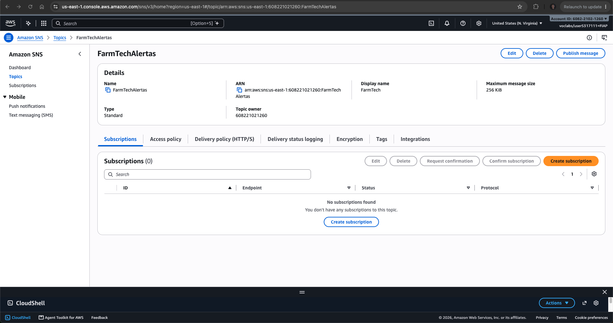
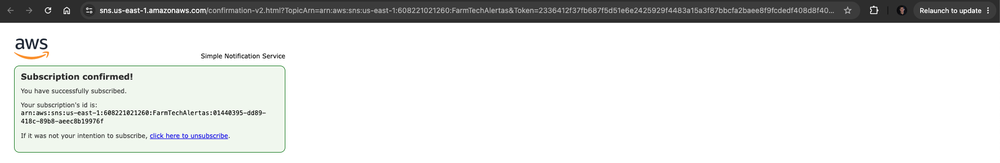
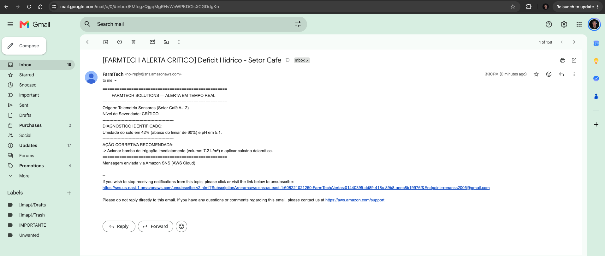

# ☁️ Evidências de Provisionamento AWS SNS — Mensageria em Nuvem (Fase 7)

## 1. Identificação do Recurso

- **Serviço AWS:** Amazon Simple Notification Service (Amazon SNS)
- **Nome do Tópico:** `FarmTechAlertas`
- **Tipo:** Standard (Suporte a protocolos Email e SMS)
- **ARN do Tópico:** `arn:aws:sns:us-east-1:608221021260:FarmTechAlertas`
- **Região de Laboratório:** `us-east-1` (US East - N. Virginia)
- **Região Arquitetural de Produção:** `sa-east-1` (São Paulo - LGPD Compliant)

> **Nota de Governança de Nuvem:** A arquitetura empresarial da FarmTech Solutions adota como premissa a região **São Paulo (`sa-east-1`)** por conformidade com a LGPD e menor latência para sensores no Brasil (conforme defendido na Fase 5). No entanto, o provisionamento prático no ambiente de estudante (**AWS Academy Learner Lab / Voclabs**) foi executado em **`us-east-1`** devido às restrições de permissão IAM impostas pela política de laboratório acadêmico.

---

## 2. Evidências do Console da AWS

### Evidência 1: Tópico Criado no Amazon SNS

Configuração do tópico Standard `FarmTechAlertas` provisionado na conta acadêmica:

### Evidência 2: Assinatura de E-mail Confirmada

Assinatura de protocolo Email configurada e confirmada via link criptográfico:

### Evidência 3: Notificação em Tempo Real Recebida

Disparo da mensagem de alerta simulando déficit hídrico crítico na lavoura, entregue diretamente na caixa de entrada do operador da fazenda:

